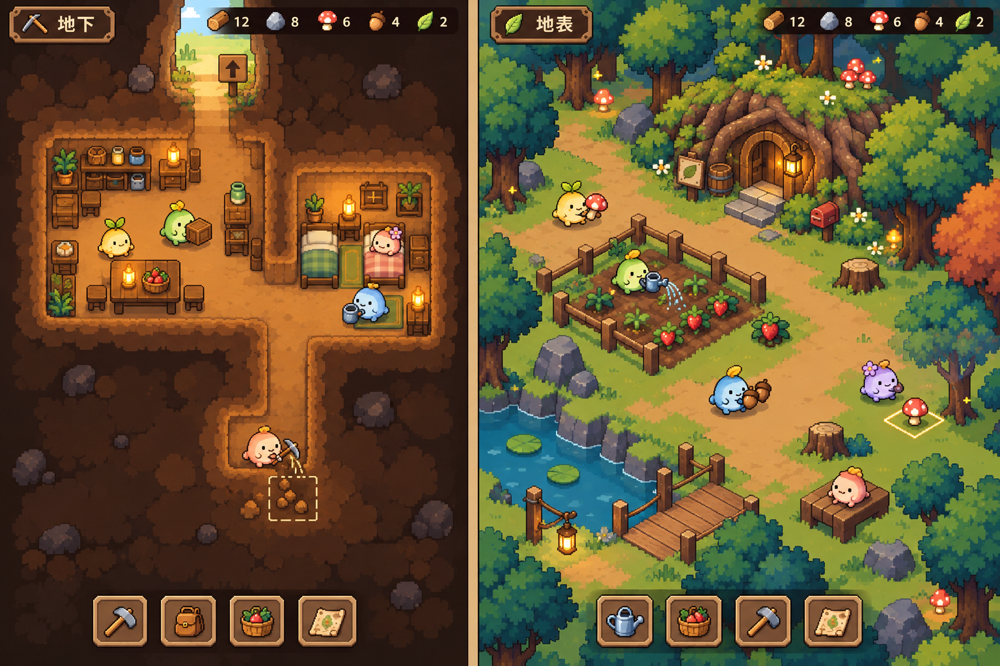
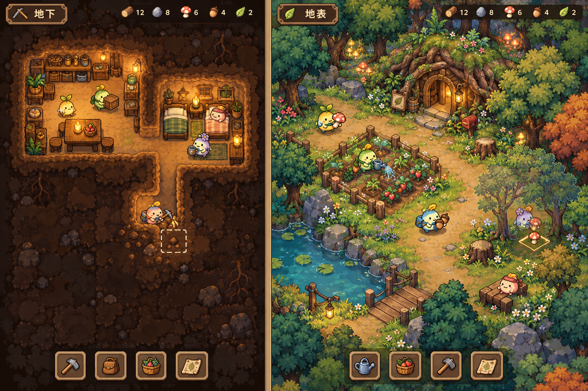

# 場景概念圖

這兩張圖保留原始 PNG 位元內容，只整理檔名。v2 是目前規格採用的簡化方向，v1 保留作為迭代紀錄。

| 檔案 | 原始名稱 | 產出日期（洛杉磯） | 用途 |
| --- | --- | --- | --- |
| [v1](slime-colony-concept-v1.png) | Cozy slime colony: underground and surface.png | 2026-10-12 | 第一版場景概念，保留暖光、森林與地下聚落的氣氛 |
| [v2](slime-colony-concept-v2.png) | Cozy pixel slimes: underground and surface.png | 2026-10-13 | 第二版簡化概念，減少細碎地面，突出泡泡與採集物 |

## 目前方向

暖光、自然童話、清楚像素塊與簡單可辨識的泡泡。減少細密材質、碎花與草點；夢幻感集中在少量發光植物。地下與地表角色維持接近的顯示尺度，互動資源須容易辨識。

概念圖展示發展後的生活情境。正式開局仍以規格書為準：五隻泡泡在洞外，洞內只有一個小房間與一個箱子。圖中的多房間、床鋪、橋與家具不代表開局配置；介面數字與格子尺度不作為實作數值。這些圖片尚未拆成可用的圖集或動畫素材。

## 最新概念 v2

## 早期概念 v1

